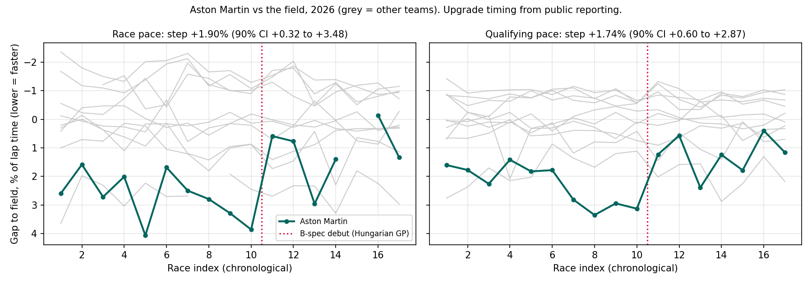
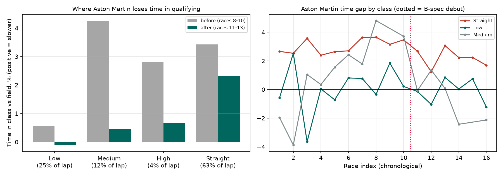

# Development Radar

**Can public lap-time data tell us whether a mid-season F1 upgrade worked, and how sure can we be?**

This repo turns public timing data into a per-team, per-race pace gap (race and qualifying), tests for step changes, and, just as importantly, states how large a step has to be before the method can see it at all.

Everything below is reproduced by the commands in [Reproduce](#reproduce). Data: 2026 season, 17 races (`data/`).

## Results

| Question | Answer |
|---|---|
| How big must an upgrade be to be reliably detected? (80% power, 5% one-sided test) | **Qualifying 0.6-0.8%, race 0.8-1.0% of lap time**, depending on when it lands. Roughly 0.5-0.9 s on a ~90 s lap. |
| Did Aston Martin's B-spec step show up? (upgrade timing taken from public reporting, Hungarian GP = race 11) | **Yes, in both sessions:** race pace **+1.90%** (90% CI +0.32 to +3.48), qualifying **+1.74%** (90% CI +0.60 to +2.87). See caveats below. |
| **Where** did Aston's step come from? (qualifying telemetry, corner-speed classes) | Mostly **straight-line time** (+1.10%, CI +0.51 to +1.68, about 0.7 of the ~1.6 points of lap time) and **low-speed corner time** (+1.54%, CI +0.52 to +2.57, about 0.4 points). Low-speed *apex speed* did not change (-0.12%, CI -1.24 to +1.00), so the low-speed gain is in entry and exit, not mid-corner speed. Medium/high-speed apex speed rose about +3% but rests on 2-3 races per side. See [corner analysis](#corner-speed-class-analysis-qualifying-telemetry). |
| Does a one-race-ahead forecast beat a 3-race rolling median? | **No.** Median beats "last race" in qualifying (MAE 0.344 vs 0.384, CI of the difference excludes 0); nothing beats the median. |
| Would a track-characteristics factor help? | **No, even with weekend-measured descriptors.** The oracle ceiling is no better than the median (qualifying: +0.001, CI -0.005 to +0.009; race: slightly worse, +0.017, CI +0.003 to +0.033). |
| Are 90% prediction intervals calibrated? | Qualifying 86.0% raw, 91.7% after causal recalibration. Race 92.4% raw, 88.2% recalibrated. With ~120 forecasts the sampling error is about +/-3 points, so treat both as "roughly calibrated". |



### How to read the Aston result

- **Timing is pre-specified, not read off the data.** F1Technical, PlanetF1 and Crash.net all report the B-spec AMR26 (16 new parts) debuting at the Hungarian GP, which is `RaceIdx` 11 in `data/race_order_2026.csv`.
- **It is large and specific to Aston.** The same test on the other ten teams gives nothing comparable in race pace (no CI excludes zero). In qualifying, Alpine (+0.45%) and McLaren (+0.37%) have small positive steps; Aston's is about four times larger.
- **It is stable to the window**: +1.4% to +2.9% (race) and +1.4% to +2.1% (qualifying) for 2-5 races either side.
- **But it rests on three races per side.** Dropping Hungary or the Dutch GP from the race-pace post-window pushes the race CI across zero (qualifying stays above zero). Race 13 (Monza) is back near the pre-upgrade level.
- **It is not an aero-only estimate.** A second change (Honda power-unit improvements) was reported from the Dutch GP (race 12), so the post-upgrade window mixes two changes. Hungary and Zandvoort are also low-speed circuits, and a car can be relatively better at some circuits regardless of upgrades. The step is consistent with a real improvement; it is not proof of what caused it.

## Method

| Module | What it does |
|---|---|
| `devradar/pace.py` | Race pace from laps: green-flag, slick-tyre, non-pit, clean-air (>1.5 s to the car ahead) laps; one regression per race, `LapTime ~ driver + compound + compound:TyreLife + lap_number`. Driver effects are the pace (tyre degradation and fuel burn/track evolution are corrected). Team pace = mean of its drivers; gap = % to a trimmed-mean field reference. |
| `devradar/quali.py` | Qualifying pace: best valid lap per driver per segment, `100*ln(t) ~ driver + segment`, team gap vs a trimmed-mean field reference. |
| `devradar/trend.py` | `step_effect`: before/after test around a known upgrade race with inverse-variance weights plus season-level extra scatter (conservative). Optional per-team Gaussian-process trends (`requirements-gp.txt`). |
| `devradar/causal_model.py` | No-lookahead forecasts: rolling median, plus a PCA track factor with a ridge map from circuit descriptors (oracle mode only, see below). |
| `devradar/backtest.py` | Rolling-origin backtest; paired bootstrap CIs resampled by race; interval coverage, raw and causally recalibrated. |
| `devradar/mde_simulation.py` | Power curve and minimum detectable effect, noise calibrated from the real gap matrix (race-effect sd and team scatter sd). |
| `devradar/robustness.py` | Does a team's trend survive removing shared circuit effects? Leave-one-team-out SVD factors, leave-one-race-out jackknife. |
| `devradar/synthetic.py`, `validate_synthetic.py` | Synthetic races with a planted upgrade: does the pipeline recover the truth? (Planted +0.50%, 200 seasons: mean estimate 0.504%, detection 94.0%, false-positive rate 1.0%, 90% CI coverage 99.5%. The test is deliberately conservative, so its intervals are wider than nominal; the synthetic noise is also cleaner than the real data, so real-world power is lower.) |
| `devradar/aston_report.py` | The Aston step table and figure above. |
| `devradar/corners.py`, `devradar/corner_report.py` | Corner-speed-class decomposition of qualifying laps from telemetry, and the Aston class-level step test. |
| `tests/` | Corner detection on synthetic laps with known corners and a planted +1.5% low-speed deficit; leakage tests (corrupt all future rows and descriptors, assert the forecast is unchanged, for honest and oracle modes), power-simulation sanity checks, planted-step recovery. |

Data comes from the public [TracingInsights](https://github.com/TracingInsights) lap cache (FastF1-derived); `--source fastf1` uses FastF1 directly.

## Corner-speed-class analysis (qualifying telemetry)

The lap-time gap says *how much*; this says *where on the lap*. `devradar/corners.py` splits every flying qualifying lap into corner zones by speed class and measures each team's time and apex (minimum) speed per class, with the same driver-plus-segment model as the lap-time pipeline.



**Method.** Best valid lap per driver per segment, resampled onto a 5 m grid. A field-median speed/brake/throttle profile defines the corners (local speed minima, prominence >= 20 km/h), so zone boundaries do not depend on any one car. Class by reference apex speed: Low < 120, Medium 120-200, High >= 200 km/h. A zone runs from the start of the braking block to the point where median throttle reaches 95%; everything else is "Straight". Class times add up to lap time, so the result is a decomposition: weighting each class gap by its share of the lap reproduces the independent lap-time gap with correlation 0.99 (RMSE 0.13 percentage points over 187 team-races).

**Aston Martin, qualifying, Hungarian GP (race 11), 3 races each side** (positive = faster):

| Class (share of lap) | Time in class | Contribution to lap-time step | Apex speed |
|---|---|---|---|
| Low corners (25%) | +1.54% [+0.52, +2.57] | +0.39 pts | -0.12% [-1.24, +1.00] |
| Medium (12%) | +3.52% [0.00, +7.03] (n=2 pre) | +0.42 pts | +3.23% [+0.05, +6.42] |
| High (4%) | +2.62% [-0.05, +5.30] (n=2 per side) | +0.10 pts | +2.85% [+0.53, +5.17] |
| Straight (63%) | +1.10% [+0.51, +1.68] | +0.69 pts | n/a |

- **Aston's persistent deficit is on the straights, not in the corners.** Its straight-class time was 1.2-3.7% off the field in every race with data (mean 2.8%), versus roughly field-average in low-speed corners. That pattern points at power-unit deployment, drag or energy management rather than mechanical grip, but this data cannot separate those.
- **The straight-line improvement cannot be credited to the aero upgrade.** The second change (power unit, Dutch GP) falls inside the post-upgrade window, and the lowest straight gap of the season is race 12.
- **Class-level evidence is much thinner than the lap-time evidence.** Each side has 3 races or fewer, many circuits have no high-speed class, and the placebo test finds "significant" steps for 3 of 11 teams in the Low class and 3 of 11 in the Straight class, more than a 90% interval should give. Read these as a pattern consistent with the lap-time result, not as precise attribution.
- **Race 17 has no Aston corner estimate:** its telemetry laps failed the distance sanity check (integrated length >1.5% off the median, i.e. dropouts) and were dropped rather than repaired.

Limits specific to this module: about 7 Hz telemetry, so apex speed is coarse; speed-class thresholds are a convention (`LOW_KMH`, `HIGH_KMH`); flat-out kinks with no speed dip are not detected as corners; one lap per driver per segment; qualifying only (no race stints).

## What this can and cannot claim

- It measures **relative lap-time efficiency**. It cannot separate aero from mechanical grip, tyre state, power-unit deployment or energy management (important under the 2026 regulations).
- Standard errors capture within-race sampling only. Race-wide shocks (weather, safety cars, track evolution) are handled by measuring each team against the field, not by the SEs. Teammate covariance is ignored in the SEs.
- Fuel burn and track evolution are one combined linear lap-number term per race.
- One season, 17 races, and the 2026 regulations are new, so there is no earlier history to train on. Everything here is in-sample for this one season except the rolling-origin backtest.
- `RaceIdx` is chronological position among races with data, not the official round number.
- Race 15 (Azerbaijan GP) has no race-pace estimate because it did not pass the data-quality filters; qualifying is complete for all 17 races.

### About the track factor

The circuit descriptors (`top_speed`, `mean_trap`, `track_temp`) are all measured during the weekend, so they are unknown when a pre-race forecast is made. The only honest pre-race forecast is therefore the rolling median, and the track factor is evaluated only as an **oracle upper bound** (the target race's own descriptors). An earlier version added each team's mean past residual as a "track" term; that is a momentum term, not a track effect, and it only added noise, so it was removed. A real pre-race test needs descriptors known in advance (circuit geometry, or the same circuit's values from a previous season). That is the main open item.

## Reproduce

```bash
python -m venv .venv && source .venv/bin/activate      # Windows: .venv\Scripts\activate
pip install -r requirements-dev.txt

pytest                                                  # leakage + statistics tests
python -m devradar.backtest data/gaps_quali_2026.csv data/circuit_descriptors.csv
python -m devradar.backtest data/gaps_2026.csv data/circuit_descriptors.csv
python -m devradar.mde_simulation data/gaps_quali_2026.csv
python -m devradar.mde_simulation data/gaps_2026.csv
python -m devradar.aston_report                         # Aston table + figures/aston_step.png
python -m devradar.corner_report                        # Aston corner-class table + figures/aston_corner_classes.png
python -m devradar.validate_synthetic                   # planted-upgrade recovery
python -m devradar.check_trends                         # circuit-controlled development trends
```

Rebuilding the gap tables from raw laps (needs network; set `GITHUB_TOKEN` to avoid GitHub API rate limits):

```bash
python -m devradar.run --year 2026                          # race pace
python -m devradar.run --year 2026 --session qualifying     # qualifying pace
python -m devradar.run --year 2026 --upgrade "Aston Martin:11"
python -m devradar.corners 2026                             # rebuild data/corner_gaps_quali_2026.csv from telemetry (~100 MB download, cached)
```

GP trend plots (`figures/trends_*.png`) need `pip install -r requirements-gp.txt`. `--source fastf1` needs `pip install fastf1`.

## Next

1. Pre-race track descriptors (circuit geometry, or last season's values for the same circuit) so the track factor can be tested honestly, and 2025 as an out-of-sample season.
2. Race-stint telemetry (not just qualifying) and a finer zone model (entry / apex / exit phases, mid-corner speed from lateral acceleration) to separate braking stability from traction.
3. Per-point heteroscedastic noise in the GP, and teammate covariance in the SEs.
